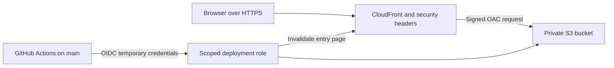

# Finance AWS deployment exercise

## Current state: checks enabled, AWS deployment disabled

The application remains available on its existing [Vercel demo](https://finance-dashboard-ui-orcin-iota.vercel.app/). This change adds an AWS CDK definition, GitHub Actions checks, staged release publishing and rollback commands. **No AWS hosting resources have been provisioned and no AWS-hosted URL exists for this exercise yet.**

The owner requested free-only operation. On 16 November 2026 the account's `GetAccountPlanState` returned `ResourceNotFoundException`; its Free Tier usage response did not confirm S3 hosting eligibility. Those observations do not establish whether the account has other credits. They do mean that zero-cost AWS hosting has not been verified, so `AWS_DEPLOY_ENABLED` remains unset and release jobs are skipped.

A [CloudFront Free flat-rate plan](https://docs.aws.amazon.com/AmazonCloudFront/latest/DeveloperGuide/flat-rate-pricing-plan.html) is a different offering from an AWS Free account plan. CloudFront's plan includes S3 **storage** credits; it does not establish that all S3 API operations are free. The stack here does not subscribe to that plan. Do not describe ordinary pay-as-you-go S3/CloudFront as guaranteed free, or treat a budget notification as a spending cap.

## What runs now

```mermaid
flowchart LR
    P[Push or pull request] --> T[Data and release-failure tests]
    T --> I[CDK type checks and infrastructure assertions]
    I --> S[Synthesize CloudFormation locally]
    S --> B[Build and checksum release]
    B --> E[Browser workflows]
    E --> A[Downloadable build and template artifacts]
    A -. disabled until free-only requirement verified .-> D[AWS staging and promotion]
```



All these checks run without AWS credentials. The GitHub Actions run displays the pipeline stages and downloadable artifacts. The synthetic account ID in the template artifact is a placeholder, not a deployed account.

## Proposed hosting architecture



AWS CDK is TypeScript in `infra/`. It synthesizes a CloudFormation template, without a CDK bootstrap stack or packaged Lambda functions. Infrastructure changes are a separate operator action; the GitHub role cannot modify IAM, provision stacks, delete objects, or reach other buckets. The role can read/write the site's release paths, list only this bucket, invalidate only this distribution, and read account-plan state. Trust pins the GitHub audience and the exact repository/main branch.

The S3 bucket blocks public access, requires HTTPS, uses S3-managed encryption and versioning, and grants origin access only to its CloudFront distribution. Deleting the stack retains the bucket, so it would continue consuming storage until explicitly cleaned up. Noncurrent object versions expire after 30 days; current release snapshots and hashed assets are retained for rollback.

## Practise locally, without AWS spend

```sh
npm ci
npm ci --prefix infra
npm test
python3 -m unittest discover -s tests/pipeline -v
npm --prefix infra run typecheck
npm --prefix infra test
AWS_ACCOUNT_ID=111111111111 AWS_REGION=us-east-1 npm --prefix infra run synth
npm run build
npx playwright install chromium
npm run test:e2e
```

Inspect `infra/cdk.out/FinanceOverviewAws.template.json`. Find the bucket's public-access block, the distribution's origin access control, the main-only role trust and the release role's permissions. Nothing is deployed by synthesis.

For a visible rollback exercise:

```sh
python3 -m unittest discover -s tests/pipeline -p test_aws_release.py -v
```

The test `test_stage_is_inert_until_promoted_and_rollback_restores_exact_entry` stages A, promotes A, stages B without changing the live entry, promotes B, and restores the original A bytes. This is an **in-memory test**, not evidence of an AWS deployment. Other tests inject interrupted uploads, altered assets, missing rollback dependencies and denied permissions.

## Release design

The build gets a `finance-release` meta tag containing its full Git commit SHA. `release.json` records each file's byte count and SHA-256 digest. The publisher validates the complete local artifact before writing, keeps immutable snapshots under `releases/<sha>/`, and shares content-hashed assets at `/assets/` without deleting older files. Conditional S3 writes reject overwriting an immutable object with different bytes.

Staging leaves the live entry untouched. The candidate at `/releases/<sha>/index.html` receives HTTP/header checks and the same browser workflows as the main demo. Promotion verifies the saved entry and dependencies, replaces only root `index.html`, and invalidates `/` and `/index.html`. The entry revalidates; immutable assets cache for one year. Missing assets retain error status rather than returning an HTML success fallback.

Deployment and rollback share a concurrency group. A superseded main commit is skipped before staging. If the post-promotion live HTTP check fails, the workflow attempts to restore the previous release. A failed invalidation or interrupted promotion still requires inspecting the live release; the root S3 write and CloudFront invalidation are separate operations, not a cross-service transaction.

Rollback restores a previously saved build without rebuilding historical source. It changes application files only; transactions remain browser-local. This is still a frontend demo with no bank connections, customer accounts or backend finance database.

## Cloud activation requirements (currently blocked)

Do not set `AWS_DEPLOY_ENABLED=true` until the free-only requirement is verified. The supplied guard intentionally rejects paid, expired, exhausted and unconfirmed plans. Do not upgrade the account, subscribe to a paid plan, or weaken the guard to bypass this requirement.

For an account AWS explicitly confirms as `FREE` and `ACTIVE` with unexpired credit:

1. Run `python3 scripts/check_aws_free_plan.py` with your own AWS login. It reads plan metadata and makes no account changes.
2. Synthesize with the actual account ID and region. Review the generated CloudFormation template before deployment.
3. Deploy that template as stack `FinanceOverviewAws` with `CAPABILITY_IAM`. This provisions the bucket, distribution, native GitHub OIDC provider and scoped role. The account inspected for this exercise had no OIDC provider; an account that already has the GitHub provider must import/reference it instead of creating a duplicate.
4. Use the CloudFormation outputs to configure these GitHub repository **variables** (no access keys):

| Variable              | Source                                                  |
| --------------------- | ------------------------------------------------------- |
| `AWS_DEPLOY_ENABLED`  | `true`, only after the free-plan check and provisioning |
| `AWS_REGION`          | `Region` output                                         |
| `AWS_DEPLOY_ROLE_ARN` | `DeployRoleArn` output                                  |
| `AWS_SITE_BUCKET`     | `SiteBucket` output                                     |
| `AWS_DISTRIBUTION_ID` | `DistributionId` output                                 |
| `AWS_SITE_ORIGIN`     | `SiteUrl` output                                        |

5. Run **Finance checks and AWS release** on `main`. Inspect the checks, candidate browser results and live check before calling it deployed.
6. Practise **Restore an AWS finance release** on `main` with a full previously staged SHA. The workflow applies the same free-plan guard.

The guard uses AWS plan metadata and can block writes; it cannot prevent charges from resources outside this exercise or make an already-paid account free. GitHub-hosted standard runners are [free for public repositories](https://docs.github.com/en/billing/concepts/product-billing/github-actions); private repositories have plan-specific allowances. Artifacts here expire after seven days (diagnostics after three).

## Evidence to add after an actual deployment

Keep an Actions run link, the real CloudFront URL, a screenshot showing release A → B → A, actual billing observations, and one deployment failure you diagnosed. Until then, describe this as a tested infrastructure/pipeline exercise with cloud activation pending. Do not advertise AWS production experience or a live rollback you have not performed.
